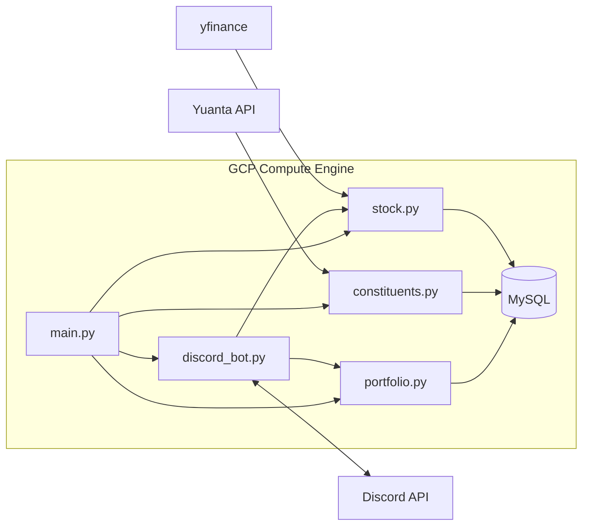

# TW Stock Tips — Portfolio + 0050 Discord Bot (GCP VM)

## Overview

GCP Discord bot for TW stocks—track your personal buys/sells (avg cost, P&L, dates), poll every 10 minutes, and also flag 0050 sharp movers vs open with quarterly constituent refresh.

## Requirements locked in

- Market: **Taiwan (`.TW`) only**
- **Personal portfolio (priority):** stocks you already own — average buy price, price moves, purchase dates, and a log of new buys/sells
- **0050 context:** track Taiwan 50 constituents (Yuanta API); refresh **Mar / Jun / Sep / Dec**; routine digest highlights **sharp rise/fall vs open** (≥ **2%**, configurable)
- Discord bot: send digests + accept commands to record trades and query positions
- Poll every **10 minutes** → MySQL history → Discord
- Prices: **free `yfinance` only** (no paid quote API)
- Holdings: try Yuanta `StkWeights?fundid=1066` JSON; if unavailable, use bundled [`data/0050_constituents.json`](data/0050_constituents.json) (update that file when the quarterly basket changes)
- Host: **GCP Compute Engine** + MySQL on the **same VM**
- Skip BeautifulSoup; use `requests` for Yuanta JSON only

### Price & lot rules

- Use a **single price** per ticker: the **last / current traded price** (`price`). Do **not** store or show bid/ask.
- Compare moves as: `% vs last price` against **open** (sharp movers) and against **avg_cost** (portfolio P&L).
- **Odd lots (零股) allowed:** any positive share count (not forced to 1000 / 一張).
- No brokerage fee modeling in v1.

### Portfolio input defaults

- Record buys/sells via **Discord commands**
- Every 10‑min Discord message has **two sections**: (1) **your positions** always, (2) **0050 sharp movers**

## Architecture



**Poll flow:** refresh constituents if due → load open positions + 0050 tickers → batch quotes → write `price_history` → build portfolio P&L + sharp-mover list → post Discord → check `/alert` rules.

## Critical fix

Rename `discord.py` → **`discord_bot.py`** (avoids shadowing the `discord` package).

## Files

| File | Role |
|------|------|
| `main.py` | Wire config, DB, loops |
| `database.py` | Parameterized queries |
| `portfolio.py` | Buy/sell ledger + position aggregates |
| `constituents.py` | 0050 from Yuanta |
| `stock.py` | Quotes + `% vs open` / `% vs avg cost` |
| `discord_bot.py` | Commands + scheduled digest |
| `requirements.txt` | Dependencies |
| `config.ini.example` | Config template |
| `create_env.bash` / `start_project.bash` | Setup / run |

## Config

```ini
[DATABASE]
HOST=localhost
PORT=3306
USER=root
PASSWORD=...
DATABASE=Stock

[DISCORD]
TOKEN=your_bot_token
CHANNEL_ID=1234567890

[STOCK]
POLL_INTERVAL_MINUTES=10
SHARP_MOVE_PCT=2.0
CONSTITUENT_REFRESH_MONTHS=3,6,9,12
ETF_FUND_ID=1066
```

## MySQL schema

### `transactions` (source of truth)

- `id`, `ticker`, `side` (`buy`|`sell`), `shares` (DECIMAL, odd-lot OK), `price` (single fill price), `trade_date`, `note`, `created_at`
- Sells must not exceed current open shares

### `positions` (derived after each trade)

- `ticker` (PK), `shares` (DECIMAL), `avg_cost`, `first_buy_date`, `last_trade_date`, `realized_pnl`

### `price_history`

- `price` (last), `open`, `pct_vs_open` — **no bid/ask**

### Also

- `constituents`, `alerts`

### Avg cost rule

- **Buy:** `avg_cost = (old_shares * old_avg + buy_shares * buy_price) / (old_shares + buy_shares)`
- **Sell:** reduce shares; keep `avg_cost` on remaining; realized PnL `(sell_price - avg_cost) * sold_shares`
- Shares → 0: clear position row (history stays in `transactions`)

## Discord

### Scheduled digest (every 10 min)

1. **My portfolio** (always if open positions): shares, avg cost, first buy date, last price, unrealized PnL / % vs avg, % vs open today
2. **0050 sharp movers** (≥ `SHARP_MOVE_PCT` vs open); if none: short “no sharp movers” line

### Commands

- `/buy 2330 10 980 2024-01-15` — ticker, shares (零股 OK), single fill price, optional date
- `/sell 2330 3 1050 2024-06-01`
- `/portfolio` — positions + live P&L
- `/trades [2330]` — buy/sell history
- `/constituents` / `/constituents refresh`
- `/quote 2330`
- `/alert …` — optional custom thresholds

## Implementation order

1. Rename + deps + config
2. DB tables + safe queries
3. `portfolio.py`
4. `constituents.py` + `stock.py`
5. Discord commands + 10‑min digest in `main.py`
6. Scripts / GCE notes

## Out of scope (v1)

- Multi-user portfolios / brokerage sync
- Bid/ask quotes or paid market-data APIs
- BeautifulSoup HTML scraping
- Fees/taxes beyond optional `note`
- Forcing 1000-share lot sizes
- Charts, Cloud Run, Cloud SQL
- Per-field Discord display pickers

## Implementation todos

- [ ] Rename `discord.py` → `discord_bot.py`; requirements + config
- [ ] DB schema: constituents, price_history, alerts, transactions, positions
- [ ] `constituents.py`: Yuanta 0050; refresh Mar/Jun/Sep/Dec
- [ ] `portfolio.py`: odd-lot buy/sell; avg cost; dates; P&L
- [ ] `stock.py`: single last price + open via yfinance
- [ ] `discord_bot.py`: commands + digest
- [ ] `main.py`: wire poller
- [ ] Bash scripts + GCE notes
